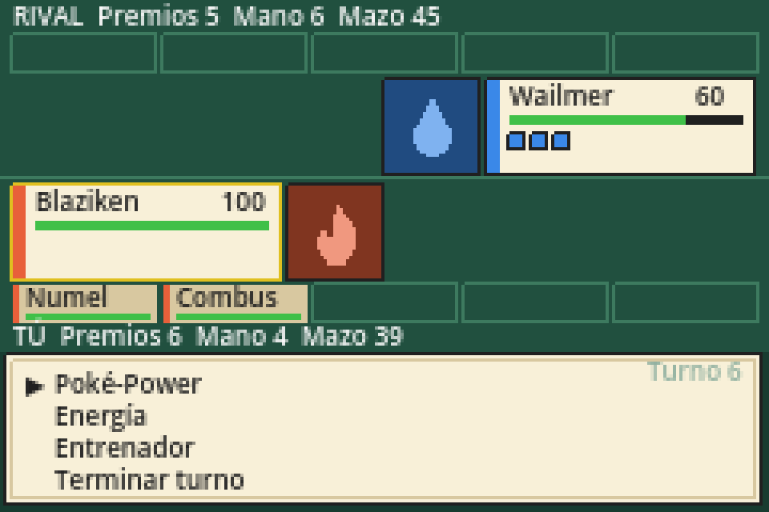
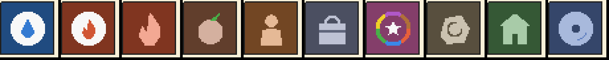
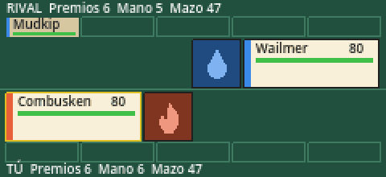
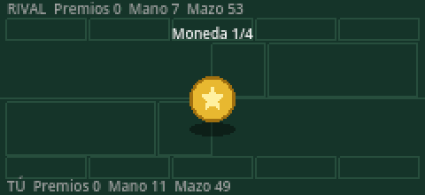
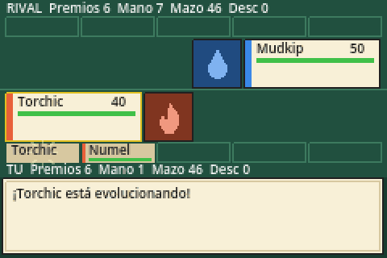
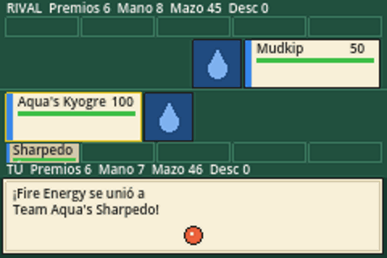
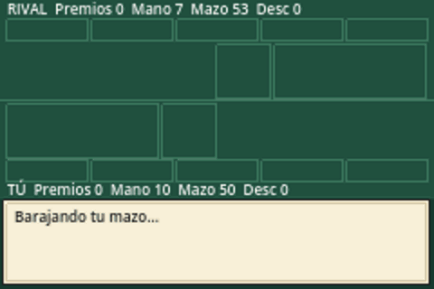
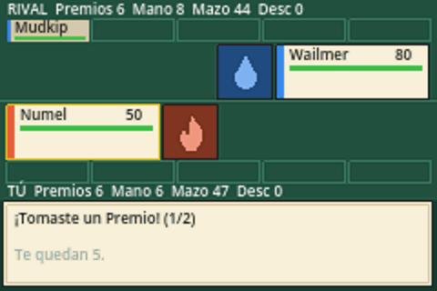
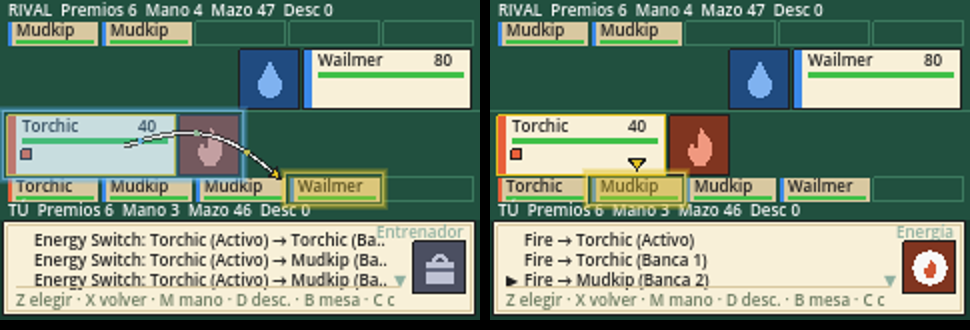
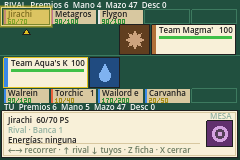

# Advance EX TCG — Era ADV

Simulador del Pokémon TCG de la **era ADV** (temporadas 2003-04 y 2004-05: de *Expedition*
a *EX Emerald*) con estética de Game Boy Advance, hecho en **Godot 4.3**.

El juego está todo en **inglés** (menús, registro, campaña y diálogos), igual que el texto
de las cartas. Esta documentación y los comentarios del código siguen en castellano.



| Set japonés | Set en inglés | Id |
|---|---|---|
| ADV Expansion Pack | EX Ruby & Sapphire | ex1 |
| Miracle of the Desert | EX Sandstorm | ex2 |
| Rulers of the Heavens | EX Dragon | ex3 |
| Magma VS Aqua: Two Ambitions | EX Team Magma vs Team Aqua | ex4 |
| Undone Seal | EX Hidden Legends | ex5 |
| Flight of Legends | EX FireRed & LeafGreen | ex6 |
| Rocket Gang Strikes Back | EX Team Rocket Returns | ex7 |
| Clash of the Blue Sky | EX Deoxys | ex8 |
| — (solo en inglés) | EX Emerald | ex9 |
| — | POP Series 1 | pop1 |
| — | Nintendo Black Star Promos 001–027 | np |

Además están los tres sets e-card que seguían siendo legales en 2003-04 (Expedition,
Aquapolis y Skyridge: `ecard1`–`ecard3`). Cada temporada usa sus sets y sus reglas:
**2003-04** (Expedition a Hidden Legends, promos 001–026) y **2004-05** (Ruby & Sapphire a
Emerald, POP Series 1 y promos 001–027, el formato del Mundial 2005). Todas las cartas
están programadas: ataques, Poké-Powers, Poké-Bodies, Entrenadores y Energías especiales
(Pokémon Dark y Rocket's, Pokémon ★, Dark Metal, R, Scramble, Heal Energy...).

Los datos vienen de la base en inglés, así que los textos de las cartas están en inglés.

## Cómo jugarlo

1. Instalá [Godot 4.3 o superior](https://godotengine.org/download) (versión estándar).
2. Godot → **Importar** → elegí `project.godot`.
3. **F5**.

| Tecla | Joystick | Acción |
|---|---|---|
| Flechas | Cruceta | Moverse · ←/→ en el título cambian mazo, rival y reglas; en el menú principal, ◀▶ cambia de columna |
| Z / Enter | A | Aceptar |
| X / Esc | B | Volver · en el menú principal abre la pausa |
| P | Start | **Pausa**: velocidad, efectos, música, mesa, controles y **rendirse** |
| M | L | Ver tu mano (Z o C sobre una carta muestra su ficha) |
| D | R | Ver la pila de descartes (←/→ cambia entre la tuya y la del rival) |
| B | Y | Recorrer la mesa: ←/→ pasa por todos los Pokémon, ↑ salta al lado rival y ↓ al tuyo; Z abre la ficha |
| C | X | Ficha de la carta seleccionada (en el menú principal: los dos Activos y el Estadio). Dentro de la ficha, ▲▼ lee el resto del texto (se frena al final) y ◀▶ pasa a la carta de al lado: la siguiente de la mano, el siguiente Pokémon de la mesa o la siguiente de la lista del editor |
| Tab | Select | Registro de la partida |

**Moneda inicial**: antes de cada duelo elegís cara o cruz. Con las reglas de 2004-2007, el
que gana la moneda elige si empieza o no; con las de 2003, el que la gana empieza
([reglas del primer turno por año](https://ptcgarchive.com/first-turn-rules-full/)).

**Batallas dobles (2 contra 2)**: en el título, la fila *Battle* elige *Singles* o
*Doubles (2 vs 2)* (por defecto, Singles). Siguen la variante "2-on-2" del reglamento de la era EX:
- hasta **2 Pokémon Activos** por jugador y **4 en la Banca**; en la preparación se pueden
  poner dos Activos, y durante el turno se puede mandar uno de la Banca al lugar vacío;
- **un solo ataque por turno**: elegís cuál de tus Activos ataca y **a cuál** de los Activos
  del rival (en el menú se marcan los dos sobre la mesa); "each Defending Pokémon" afecta a
  los dos;
- **una sola retirada por turno**; Switch, Pokémon Reversal y compañía preguntan cuál de los
  Activos se cambia;
- los estados afectan a cada Pokémon por separado y el chequeo entre turnos revisa a los
  dos Activos; si cae uno, se reemplaza con uno de la Banca (sin Banca, el otro queda solo);
- los Premios no cambian (6, un ex da 2). En las dobles no hay animación de cara a cara.

Por dentro, cuando actúa el segundo Activo el motor lo pone un momento en el lugar del
primero ("contexto"), así el texto de todas las cartas ("your Active Pokémon", "the
Defending Pokémon") vale sin reescribirlas.

**Resultados**: al terminar se ve quién ganó y por qué, los Premios, KO y daño total de cada
uno, y el Pokémon que más daño hizo de cada lado (con su imagen), como en TCG Live.

## Campaña

**Se está rehaciendo desde cero.** Por ahora:

- En el título, **Campaign**. La primera vez elegís tu **nombre** con un teclado en pantalla y
  uno de los tres **mazos iniciales** (`data/campana.json` → `starters`). Después aparecés en
  la **Escuela de Entrenadores** (Trainer's School), caminando.
- **Flechas** caminan de a casilla (un toque corto solo gira), **Z** habla o mira lo que tenés
  enfrente y **X** abre el menú: *Your decks* (tus 4 mazos: editarlos con tu colección, elegir cuál usar en los duelos, cambiarles el nombre, copiarlos y vaciarlos), *Start over* (borra la
  partida, pide confirmación), *Back to title* (guarda dónde estás).
- La escuela (el doble de grande que la del juego) tiene dos maestros y quince chicos:
  algunos sentados en sus pupitres, otros charlando o mirando el pizarrón. Las dos puertas del
  fondo salen al **patio de duelos** (dos canchas con su mesa, y el director arriba). Los diálogos son de relleno y
  solo dos alumnos juegan duelos, hasta que se escriba la historia. Al ganar, el rival dice lo
  suyo y se abren los **sobres**; las revanchas se destraban al vencer al director.
- **Moverse**: flechas para caminar; manteniendo Shift (o X, o B en el joystick) se corre al
  doble de velocidad. X sola abre el menú.
- **Efectos**: entrada a cada duelo con destellos y franjas y la presentación del rival (con
  su sprite del mapa); ventanas que se deslizan; golpes con temblor, destello y número que
  salta (más exagerados contra la Debilidad); íconos de estado de Mystery Dungeon sobre los
  Pokémon (Poké-Power usable o negado, efectos del rival, escudo, más o menos daño y las
  Condiciones Especiales; `tools/armar_estados.py`).
- **Dinero (₽) y tienda**: se gana en los duelos y se ve en el menú (X). La puerta de la
  entrada lleva a la **Card Shop** de Bridgette, una pantalla aparte (como las tiendas de
  los juegos) que vende sobres de cada expansión; cada sobre comprado se abre en el momento,
  con una animación del sobre rompiéndose (con la imagen de cada expansión, `tools/armar_sobres.py`).
  El fondo y Bridgette (que parpadea y sonríe al comprar o despedirte) se arman con
  `tools/armar_tienda.py` y van en `mundo/propios/` (no vienen con el juego).
- **Cómo cambiar diálogos, quién juega, con qué mazo, qué premio da y qué vende la tienda**:
  `data/LEEME_CAMPANA.txt`.
- **Sobres**: cada sobre trae 9 cartas: 4 comunes, 3 infrecuentes, 1 reverse holo y 1 rara,
  que a veces es holo o ex. Se abren carta por carta y las nuevas se marcan. Con todas a
  la vista, las flechas recorren el sobre y C abre la ficha de la carta marcada (◀▶ pasa
  a la siguiente del sobre).
- **Secret rare**: no salen en los sobres; pueden ser regalos de personajes (`"regalo"` en la
  ficha de un personaje del mapa: `{"id", "cartas", "requiere": {"vencer": "id" | ["id", ...],
  "vencidos": n}, "dar": [frases], "despues": [frases]}`; se dan una sola vez).
- **Reverse holo**: una carta de cada sobre sale en versión reverse holo. Es solo estética: el
  brillo va en el marco. En el editor aparecen con una "R" de colores y en tus duelos de
  campaña se ven con el marco brillante.
- El progreso (colección, mazo, rivales vencidos y dónde quedaste) se guarda solo en
  `user://campana.json`.

**Datos**: `data/campana.json` tiene el mapa y la casilla del comienzo (`inicio`), los mazos
iniciales, las revanchas (`recompensas`) y los **rivales** (nombre, mazo, nivel de la IA de 1 a
5, de qué expansión son los sobres que da y cuántos, frases antes y después del duelo, y
`requiere` opcional para que no se pueda jugar con él hasta haberle ganado a otros).

### Mapas

Los mapas están en `data/mapas/<id>.json`: las baldosas son letras (se editan a mano) y los
personajes, objetos y salidas se describen ahí mismo (ver `mundo/LEEME.txt`). Un mapa puede
tener un **fondo**: una imagen del mapa entero (`mundo/propios/<fondo>.png`, del tamaño exacto
del mapa en casillas de 16×16) que se dibuja en lugar de las baldosas; las letras siguen
diciendo dónde se puede caminar. Así está hecha la escuela, armada con las piezas de la Escuela de
Entrenadores de Ciudad Férrica (`tools/armar_escuela.py <hoja de interiores>`); el patio, con las
baldosas de exteriores de Esmeralda y las mesas y bancos de la hoja POKémapPARTS
(`tools/armar_patio.py <hoja de exteriores> --piezas <hoja de piezas>`); sin esas
imágenes se ve un patio de pixel art original (`tools/make_patio.py` → `mundo/fondos/`). Esas imágenes y los sprites de personajes sacados de los
juegos originales van en `mundo/propios/`, que no se incluye en el paquete del código: sin
ellos, el mapa se ve con las baldosas genéricas y personajes de reemplazo. El código está en
`scenes/overworld.gd` (mapas) y `scenes/campaign.gd` (pantallas).

## Letra propia

Si en `fonts/` hay un `propia.fnt` con su `propia.png`, el juego usa esa letra en lugar de la
original; los caracteres que le falten (★, ✓, ◀…) salen de la original. Para armarla desde una
imagen con filas de letras: `python3 tools/hoja_a_fuente.py hoja.png descripcion.json` (el
script explica cómo describir dónde está cada fila). Esos archivos son tuyos y no se incluyen
en el paquete del código. Para volver a la letra original, borrá o renombrá `propia.fnt`.

## Imágenes de las cartas

Cada carta tiene un recuadro de imagen: junto al Activo (retrato), en la ficha (tecla C)
y a la derecha del menú cuando elegís qué Entrenador, Energía o Pokémon jugar.
Por defecto se muestra un ícono original según el tipo de carta:



(Energía básica, Pokémon por tipo, Herramienta, Supporter, Objeto, Energía especial,
Fósil, Estadio y Technical Machine.) Debajo del menú se muestran siempre las teclas
disponibles.

**Cartas holo**: imitan el holo "cosmos" de las cartas de la época. El juego separa el fondo de
la ilustración del Pokémon (los colores parecidos al borde y conectados con él) y le pone encima
una capa: el fondo se apaga con un tinte frío y se llena de los "redondeles" del cosmos
(puntitos, discos, anillos y algunos círculos grandes con halo) que van cambiando de color por
el arcoíris y se prenden a destiempo, como al inclinar la carta, mientras el Pokémon queda
limpio. La cantidad de cada tamaño está en `_build_cosmos` (la lista `kinds`). Cada unos 8 segundos el efecto se desvanece un momento
y se ve la ilustración original, como al girar una carta de verdad. Además, una franja de luz la
cruza cada tanto (arcoíris en las holo ex y las secretas). Todo es una capa encima: tus imágenes
no se modifican. Los tiempos y la intensidad están en `scenes/duel.gd` (`COSMOS_*`).
Además, las imágenes escaneadas de cartas holo traen el brillo "cosmos" del papel
(puntitos de colores). Al achicarlas quedaban como ruido, así que el juego las limpia solo con un
filtro de mediana (según `data/rarezas.json`). Tus archivos no se tocan; si preferís verlas tal
cual, poné `HOLO_FILTER := false` en `scenes/duel.gd`.

## Íconos de Energía

Los costos de los ataques (en el menú y en la ficha), la Debilidad, la Resistencia, la
retirada y las Energías unidas en el panel del Activo se muestran con íconos. Por
defecto son círculos del color del tipo con su emblema; para usar tus propios dibujos
poné en `sprites/` alguno de estos archivos (cualquier tamaño, se achican solos):

| Tipo | Archivo | o también |
|---|---|---|
| Planta | `energy_grass.png` | `energia_planta.png` |
| Fuego | `energy_fire.png` | `energia_fuego.png` |
| Agua | `energy_water.png` | `energia_agua.png` |
| Rayo | `energy_lightning.png` | `energia_rayo.png` |
| Psíquico | `energy_psychic.png` | `energia_psiquico.png` |
| Lucha | `energy_fighting.png` | `energia_lucha.png` |
| Oscuro | `energy_darkness.png` | `energia_oscuro.png` |
| Metal | `energy_metal.png` | `energia_metal.png` |
| Incoloro | `energy_colorless.png` | `energia_incoloro.png` |
| Rainbow / Multi (cualquier tipo) | `energy_rainbow.png` | `energia_arcoiris.png` |

Conviene que sean cuadradas y con fondo transparente. Se ven a 7–8 píxeles.

## Estilo visual (GBA)

Todo se dibuja a píxel exacto en 240×160 y se agranda, como en una GBA, con colores
vivos de 15 bits:

- **La mesa**: la **Clásica** es roja del lado rival y azul del tuyo. En el título, la
  opción **Mesa** elige otro fondo: Bosque, Sabana, Desierto, Ciudad, Risco, Volcán,
  Nieve, Cueva, Playa, Fondo marino, Río, Cielo, Lunares, Máquina, Baldosas, Estrellas
  o Liso. Son dibujos originales en pixel art (`tools/make_backgrounds.py`), inspirados
  en temas como los fondos de caja de PC de la 3ra generación. Con un fondo temático, el
  lado del rival se ve un poco más oscuro. **Podés agregar los tuyos**: cualquier PNG en
  `fondos/` (ideal 240×112) aparece en la lista; el número del principio del nombre de
  archivo solo sirve para ordenarlos (ver `fondos/LEEME.txt`).
- **Las cartas** se ven como cartas EX: borde amarillo, marco del color del tipo y la
  ilustración. El Activo es una carta grande con su recuadro de nombre, barra de PS
  (verde, amarilla o roja), condiciones y Energías; la Banca son cartitas con los PS
  que les quedan en números y las Energías como cuadraditos.
- **Premios** como dorsos de carta; **mazo, mano y descarte** con íconos y números.
- **Cuadros de texto y menús** como los de Ruby/Sapphire: el menú principal pregunta
  "¿Qué hará...?" con las opciones en dos columnas (◀▶ cambia de columna, ▲▼ de fila);
  en las listas, a la derecha se ve el costo y el daño del ataque o la carta elegida.
- **La letra** es una fuente pixel propia, dibujada a mano para el proyecto
  (`tools/gba_font.py`, se genera con `python3 tools/make_font.py` en `fonts/gba.fnt`),
  con la sombra de tres lados de los juegos de GBA, tildes, ñ, ¡ y ¿.

## Retratos del Pokémon Activo

Lo mismo vale para cualquier carta, incluidos Entrenadores y Energías
(p.ej. `Professor Birch.png`, `Fire Energy.png`). Cada carta en la mesa tiene una ventana para su ilustración. Por defecto muestra un emblema
original del tipo (llama, gota, hoja, rayo...). Para ver una ilustración, poné tus
propias imágenes en la carpeta `sprites/` del proyecto (o en `user://sprites/` si
exportás el juego). El juego busca, en este orden:

1. `ex1-3.png` — el id de la carta (solo esa versión). La lista completa está en `listas/lista_de_cartas.csv`, y el id también aparece en la ficha de cada carta (tecla C).
2. `Blaziken.png` — el nombre de la carta
3. `Kyogre.png` — la especie (sirve para "Kyogre ex" y "Team Aqua's Kyogre")

Cualquier tamaño sirve (lo ideal: cuadradas). Se ajusta a la ventana cuadrada de la carta (36×36 en el Activo, 14×14 en la Banca), se le da un poco más de color y se reduce a unos 15 colores de 15 bits, como un sprite de GBA.
El proyecto no incluye imágenes de Pokémon; las que agregues son para tu uso personal.

## Orden de las animaciones

- **Monedas con imagen**: si hay monedas en `mundo/propios/monedas/` (`tools/armar_monedas.py`),
  cada partida usa una al azar, más grande (cara a color, cruz en gris).
- **Monedas primero**: si un ataque, Entrenador o Poké-Power tira monedas, primero se ve la
  moneda (1,5 segundos cada una; Z la acelera) y después pasa lo que tenga que pasar
  (daño, efecto, KO). El resultado se calcula antes en una copia de la partida: como el
  motor es determinista, las monedas de la copia son exactamente las reales (hay una
  prueba que lo verifica). Las monedas del cambio de turno (Dormido, Quemado) se ven
  después del ataque.
- **KO y después el Premio**: primero el Pokémon se desvanece y recién después aparece la
  carta del Premio.
- **Recuperar del descarte**: cuando una carta vuelve de la pila de descarte a la mano, se
  la ve volar del descarte a la mano.
- **Cambios de lugar**: al bajar un Básico a la Banca la carta sube desde la mano (la del
  rival baja desde arriba); al retirarte, los dos Pokémon se cruzan en arcos opuestos; al
  pasar al puesto Activo (después de un KO, con Switch o por un ataque) la carta viaja y
  crece hasta el lugar del Activo, y el resto de la Banca se corre. Lo que viene del mazo
  (ataques que buscan Pokémon) sale de la pila del mazo.
- `tests/anim_order.gd` juega partidas por la pantalla y revisa este orden.

## Animaciones de ataque

Cada ataque tiene una animación corta según el tipo del atacante: bolas de fuego
(Fuego), chorro de gotas (Agua), hojas (Planta), rayo con destello (Rayo), ondas
(Psíquico), embestida con impacto (Lucha), tajos en la oscuridad (Oscuro) y
esquirlas (Metal). El defensor tiembla y aparece el daño flotando.
Todo está dibujado por código en `scenes/duel.gd` (sección "Animaciones de ataque").



### Animaciones especiales

Algunos Pokémon tienen su propia animación, pero **solo cuando le pegan a su rival**
(Kyogre a Groudon, Zangoose a Seviper, un inicial a otro de distinto tipo…) con un ataque
que hace daño; contra cualquier otro usan la del tipo, así se siente especial. Duran un
poco más (1,7 s) y suenan con un barrido propio:

| Pokémon | Animación |
|---|---|
| Kyogre | lluvia torrencial y una pared de agua que rompe sobre el rival |
| Groudon | sol abrasador, la tierra se agrieta y estallan columnas de magma |
| Rayquaza | una cinta verde baja en espiral desde el cielo y cae un rayo de luz |
| Mewtwo | concentra una esfera oscura y distorsiona la pantalla |
| Mew | burbujas rosadas que encierran al rival y estallan en destellos (todavía no hay cartas de Mew hasta Hidden Legends; queda lista para cuando se sumen) |
| Zangoose / Seviper | tres zarpazos rojos y una cruz / una onda venenosa que serpentea y muerde |
| Heracross / Pinsir | carga con el cuerno y lanza al rival por el aire / dos pinzas que se cierran y aprietan |
| Iniciales de Kanto | lanzallamas, lianas y ráfaga de burbujas |
| Iniciales de Johto | anillo de fuego, remolino de hojas y pétalos y mandíbulas de agua |
| Iniciales de Hoenn | patada de fuego, hojas cuchilla y chorro a presión en espiral |

Cada inicial comparte la animación con toda su línea evolutiva; el Básico la hace más
chica y la Fase 2 o el ex, a todo trapo.

**Efectos con sprites**: si en `efectos/propios/` hay tiras de cuadros (`llama.png`,
`ola.png`, `roca.png`, `explosion.png`, `estrellas.png`, `zarpazo.png`, `colmillos.png`,
`hoja.png`, `anillo.png`, `rayo.png`), estas animaciones las usan: la ola de Kyogre, las
rocas y la explosión de Groudon, las llamas de los iniciales de fuego, los colmillos de
Seviper y Totodile, etc. Cada tira que falte se reemplaza por el dibujo hecho a mano, así
que funciona con todas, con algunas o con ninguna. `tools/hoja_a_efectos.py` las recorta de
una hoja de efectos (ver `efectos/LEEME.txt`); como suelen venir de los juegos originales,
no se reparten con el código.

**Cara a cara**: cuando dos rivales clásicos quedan como Pokémon Activos, aparece una escena
corta (1,9 s) con los dos frente a frente, una vez por partida: Kyogre y Groudon,
Rayquaza con cualquiera de los dos, Mew y Mewtwo, Zangoose y Seviper, Heracross y Pinsir, e iniciales de
distinto tipo ("¡Duelo de iniciales de Hoenn!"). Z la saltea. Usa tus imágenes de
`sprites/`; si falta alguna, se ve un recuadro del color de cada uno.

Todo está en `scenes/special_fx.gd`: para darle animación propia a otro Pokémon, sumalo a
`SIGNATURE` con una de las animaciones existentes y a su rival en `RIVALRIES` (con la frase
y los colores del cara a cara); las dos cosas van juntas. Los sonidos se pueden cambiar con
`sonidos/special.ogg` y `sonidos/vs.ogg`.

Cada moneda también se anima: sube girando, cae y muestra el resultado. Hay tres
monedas distintas según el motivo:

- **Normal** (dorada): cara con estrella, cruz con anillo.
- **Quemadura** (roja): la cruz tiene una llamita; con cruz, el Pokémon recibe el daño.
- **Dormido** (azul): la cruz tiene "zzz"; con cruz sigue dormido.

Con varias monedas seguidas (p.ej. "Flip 3 coins") se ve el contador de caras.
Z acelera las monedas.



Cuando un Pokémon evoluciona (desde la mano, con Rare Candy, Wally's Training,
Baby Evolution, etc.) parpadea cada vez más rápido entre su forma anterior y una
silueta blanca, con rayos de luz, un destello y chispas.



Al unir una Energía (desde la mano, con un Poké-Power, un Entrenador o un ataque)
una esfera del color de su tipo vuela hasta el Pokémon y estalla en un destello.
Si la Energía viene de otro Pokémon (Power Shift, Energy Switch...), sale desde ese Pokémon.



Cada vez que se baraja un mazo, aparece un mazo chiquito junto al Activo: se abre
en dos mitades que se intercalan. Al robar (al empezar el turno o por un efecto) las
cartas vuelan del mazo a la mano; las tuyas se dan vuelta en el camino y abajo se
lee qué robaste. Las del rival llegan boca abajo. Z saltea cada animación.



Durante el turno de la IA hay una pausa de algo más de un segundo entre jugada y
jugada para poder leer el registro; Z la adelanta.

Al tomar un Premio, como en el juego real, elegís cuál: aparecen tus Premios boca abajo
(en dos columnas) y con las flechas y Z tomás uno; te llevás exactamente la carta de ese
lugar. Después aparece una estrella girando con la carta delante, que se da vuelta y
muestra cuál fue (los del rival se ven boca abajo). Z la adelanta.

Las Herramientas y Máquinas Técnicas unidas al Activo se ven como cartitas al costado de
su retrato (en la Banca, una cartita mínima en la esquina), y en la ficha del Pokémon
aparecen abajo, en una sección "HERRAMIENTA UNIDA" con su imagen y su texto. El Estadio
en juego se muestra con su cartita y su nombre del lado del rival, y de fondo de la mesa,
muy tenue: si ponés su imagen en `sprites/` (p.ej. `Team Magma Hideout.png` o `ex4-83.png`)
se usa esa; si no, una silueta suave.

Al jugar un Entrenador, la carta sale de la mano, se agranda en el centro de la mesa y
después va a su lugar: al descarte, al Pokémon (Herramientas y MT) o al lugar del
Estadio. Los Supporters quedan chiquitos junto al Activo hasta que termina el turno.
Las Energías que salen de la pila de descarte (Firestarter, Spiral Growth...) vuelan
desde una pilita junto al contador de descartes. Las imágenes de las cartas tienen las
esquinas redondeadas, y en la mano (M) y el descarte (D) se ve la carta seleccionada.

Cuando un Pokémon recibe daño (o se cura), la barra de vida y el número bajan de a poco;
la parte que se está perdiendo se ve en blanco.



Los nombres largos (p.ej. "Team Aqua's Kyogre") se desplazan letra por letra en la
opción seleccionada del menú, en los paneles del Activo y en la Banca.

En los menús, el Pokémon al que apunta la opción seleccionada (Energía, evolución,
Poción, retirada, objetivo de un ataque, contadores, Pokémon de la Banca rival...) brilla en
amarillo. Cuando algo **sale** de un Pokémon (Energy Switch, Power Shift, Magma Switch,
Call for Power, retirada, Switch, el atacante) ese brilla en celeste y una flecha animada
va del celeste al amarillo.


Si hay dos con el mismo nombre, el texto aclara "(Activo)" o "(Banca N)".

En la Banca cada Pokémon muestra sus PS como "actuales/máximos" con dígitos chiquitos,
en verde, amarillo o rojo según la vida que le queda; un puntito rojo avisa si tiene una
condición o una herramienta.

En la ficha (C, o Z en la mesa) el nombre va en negrita, los Poké-Powers en rojo oscuro,
los Poké-Bodies en verde oscuro y los ataques con su nombre en negrita y el costo en íconos.

Con **B** se recorre la mesa para ver cualquier Pokémon de la Banca (tuya o del rival):



## Sonido y música

Todo el sonido se genera por código al abrir el juego (ondas cuadradas, triangulares y
ruido, como en una portátil): efectos de menú, monedas, robar, barajar, Entrenadores,
Energías, evolución, KO, Premios, cambio de turno, victoria/derrota y un golpe distinto
para cada tipo de ataque. Para que no cansen, los de menú son cortos y bajos, varios
cambian un poquito de tono cada vez y el mismo efecto no se repite en ráfaga.

En el título hay dos filas: **Efectos** y **Música** (Apagado · Bajo · Medio · Alto), que
se guardan en `user://ajustes.cfg`.

La música incluida es de relleno. **Para poner la tuya**, copiá archivos `.ogg`, `.mp3` o
`.wav` en la carpeta `musica/` con estos nombres: `titulo`, `duelo`, `victoria` y `derrota`
(por ejemplo `musica/duelo.ogg`). Los efectos se reemplazan igual en `sonidos/` (la lista
de nombres está en `sonidos/LEEME.txt`). Lo que no encuentre lo sigue generando el juego.

## Dificultad del rival

En el título, **Dificultad** elige entre 5 niveles (se guarda para la próxima vez):

| Nivel | Cómo juega | Contra Normal* |
|---|---|---|
| 1 · Principiante | La mitad de las veces juega cualquier cosa | gana ~10 % |
| 2 · Fácil | Comete errores: se olvida de Entrenadores y Poké-Powers, elige mal el ataque | ~38 % |
| 3 · Normal | Puntúa cada jugada y elige la mejor; prepara la mesa y después ataca | 50 % |
| 4 · Difícil | Prueba sus mejores jugadas en una copia de la partida (sin ver tus cartas ni su mazo) y se queda con la que deja mejor la mesa | ~60 % |
| 5 · Experto | Lo mismo con más simulaciones y alternativas | ~63 % (54 % contra Difícil) |

\* Partidas IA contra IA con mazos temáticos al azar (`tests/ai_levels.gd`). En el TCG
la suerte pesa mucho (monedas, robos), así que una diferencia de 10 puntos es grande.
Ningún nivel hace trampa: la IA no ve tu mano, ni su mazo, ni el resultado de las monedas.

## Mazos incluidos

Los 10 mazos temáticos oficiales de la era, con sus listas originales de 60 cartas
(según Bulbapedia y PokéWiki):

| Set | Mazos |
|---|---|
| EX Ruby & Sapphire | **Ruby** (Blaziken, Hariyama, Delcatty) · **Sapphire** (Swampert, Grovyle, Weezing) |
| EX Sandstorm | **Oasis** (Armaldo, Sandslash, Azumarill) · **Caravan** (Cradily, Arcanine, Nuzleaf) |
| EX Dragon | **WindBlast** (Flygon, Ninjask, Magneton) · **FireFang** (Salamence, Camerupt, Crawdaunt) |
| EX Team Magma vs Team Aqua | **Team Magma** (Groudon, Aggron, Claydol) · **Team Aqua** (Kyogre, Walrein, Lanturn) |
| EX Hidden Legends | **Wish Maker** (Jirachi, Metagross, Starmie) · **Forest Guardian** (Dark Celebi, Bellossom, Dodrio) |

Todas sus cartas están programadas al 100 %. La lista de los Pokémon de cada mazo
(para poner imágenes) está en `listas/cartas_en_los_mazos.csv`.

### Mazos del Mundial 2004

Los cuatro *World Championship Decks* oficiales de 2004 (Orlando), con las listas exactas
de los finalistas. El Mundial se jugó con el formato "Expedition en adelante", así que
estos mazos usan algunas cartas de sets anteriores a la era ADV:

| Mazo | Jugador | Resultado |
|---|---|---|
| **Magma Spirit** (Team Magma's Groudon, Zangoose) | Tsuguyoshi Yamato (Japón) | Campeón, 15 años o más (invicto) |
| **Blaziken Tech** (Blaziken, Blaziken ex, Rayquaza ex) | Chris Fulop (EE.UU.) | Subcampeón, 15 años o más |
| **Team Rushdown** (Gardevoir, Gardevoir ex, Boost Energy) | Kevin Nguyen (EE.UU.) | Subcampeón, 11 a 14 años |
| **Rocky Beach** (Swampert, Swampert ex, Suicune ex) | Reed Weichler (EE.UU.) | Subcampeón, 10 años o menos |

Para eso se agregaron 13 cartas de Expedition, Aquapolis y Skyridge (solo esas): Copycat,
Pokémon Nurse, Professor Elm's Training Method, Professor Oak's Research, Pokémon Fan Club,
Town Volunteers, Desert Shaman, Friend Ball, Oracle, Underground Expedition, Weakness Guard,
Boost Energy y Warp Energy. También se pueden usar en tus mazos. La lista para poner
imágenes está en `listas/cartas_mazos_mundial_2004.csv`.

Desert Shaman pregunta a cada jugador cuántas cartas roba (0 a 4) y Town Volunteers
te deja elegir las 5 cartas que vuelven al mazo.

## Editor de mazos

En el título, **Editar mazos**:

- **Mazo nuevo (vacío)** o **Copiar** cualquier mazo (◀▶ elige cuál) para usarlo de base.
- En la edición hay cuatro pestañas (**Tab** cambia): *Mazo* (lo que tenés), *Pokémon*,
  *Entrenadores* y *Energías*. **→** (o Z) agrega una copia y **←** la quita.
- **Escribí letras** para buscar por nombre (Retroceso borra, Esc limpia la búsqueda).
- **C** muestra la ficha de la carta. A la derecha se ve la imagen y la cuenta de Pokémon,
  Entrenadores y Energías; abajo, si el mazo es válido (60 cartas, máximo 4 copias de cada
  una salvo Energías básicas, al menos un Básico) o qué le falta.
- En la lista de tus mazos: **R** renombra (escribís el nombre y Enter) y **D** dos veces borra.

Tus mazos se guardan solos en `user://mis_mazos.json` y aparecen en el título con una ★,
tanto para vos como para el rival. Un mazo que no es válido no se puede usar para jugar.

Los mazos predefinidos se editan en `data/decks.json` (formato `[id, copias]`).

## Qué está implementado

**Cobertura** (`godot --headless --script res://tests/coverage.gd`):

- 102 / 102 Poké-Powers y Poké-Bodies
- 64 / 64 Entrenadores (53 de la era ADV + 11 de sets anteriores), incluidos Estadios, Pokémon Tools, Technical Machines y Fósiles
- 767 / 767 ataques (100 %), incluidos los únicos: Genetic Memory (Kingdra ex usa los
  ataques de Horsea y Seadra), Supernatural y Chime (Sableye y Chimecho usan el efecto
  de un Supporter del rival), Silver Wind, Lizard Poison, Crushing Mantle, etc.
  Los que hablan de "el otro Pokémon Defensor" (Fast Stream, Split Blast) son para
  duelos de 2 contra 2 y acá no cambian nada.

**Reglas**: 60 cartas, 6 Premios, Banca de 5, mulligans; Muerte Súbita si los dos
ganan a la vez (partida nueva con los mismos mazos y 1 Premio cada uno); primer turno de la era EX
(el primero no roba; desde el Mundial 2004 tampoco juega Supporters); evolución,
Rare Candy; un Supporter, una Energía, un Estadio y una retirada por turno; Debilidad ×2
y Resistencia −30 solo al Activo; Pokémon-ex dan 2 Premios; las cinco condiciones
especiales; energías especiales (Rainbow, Multi, Double Rainbow, Darkness, Metal,
Aqua, Magma); Poké-Powers bloqueados por condiciones, Slaking o Muk ex.

**Elecciones**: cuando una carta pide elegir después de algo oculto (TV Reporter,
PokéNav, Dual Ball, Lady Outing...) el juego pregunta en el momento.

### Elecciones
Cada vez que una carta te deja elegir, el juego pregunta: qué Básicos poner en la Banca
con los ataques que buscan en el mazo (con "Listo" si dice "hasta"), qué ataque bloquear
con Amnesia y similares, qué Energías recuperar con Energy Restore y Magnetic Field, qué
evolución poner con Team Aqua/Magma Belt, y cuántas cartas extra robar cuando el rival
hace mulligan.

Rare Candy, según su texto, sirve para Fase 1 o Fase 2; como usarla en una Fase 1 es
igual que evolucionar normalmente, el menú solo ofrece las Fase 2.

## Estructura

```
engine/                ← motor de reglas, sin dependencias de pantalla
  game.gd                turnos, acciones legales, KO, Premios, elecciones
  attack_effects.gd      traductor de textos de ataques (condición + cláusula)
  abilities.gd           Poké-Powers, Poké-Bodies y efectos de Estadios/Herramientas
  trainers.gd            Entrenadores
  energy.gd              pago de costos y energías especiales
  simple_ai.gd           IA por puntuación
  rule_set.gd            reglas por época
  card_db.gd, decks.gd, pokemon_in_play.gd, player_state.gd
scenes/duel.gd         ← pantalla 240×160
data/cards_adv.json    ← 508 cartas de la era ADV
tools/fetch_cards.py   ← regenera las cartas (con --all baja los 16 sets EX)
tests/                 ← tests, cobertura y capturas
```

## Tests

```
godot --headless --script res://tests/run_tests.gd -- 40
```

Prueba reglas puntuales (habilidades, Entrenadores con elección, Estadios, TMs...) y
juega todos los cruces de mazos IA contra IA más partidas con acciones al azar,
comprobando en cada paso que nadie gane ni pierda cartas.
`tests/ui_smoke.gd` juega partidas enteras a través de la pantalla para comprobar que
ninguna animación se trabe.
`tests/doubles_tests.gd` prueba las batallas dobles: reglas puntuales (atacar a cada
defensor, KO del segundo Activo, una retirada, chequeo de los dos...) y partidas IA contra
IA y al azar en dobles.

## Próximos pasos sugeridos

1. Una IA mejor (mirar un turno hacia adelante) y equilibrar los mazos.
4. Campaña nueva: la historia, más mapas y rivales.
6. Batallas dobles en la campaña (rivales que juegan 2 contra 2).
7. Más animaciones especiales (otros legendarios, ataques famosos).

## Aviso

Proyecto de fans sin fines de lucro. Pokémon es marca de Nintendo, Creatures y
GAME FREAK. La letra pixel es propia del proyecto (Roboto y Tiny5, bajo SIL Open Font License, quedan en `fonts/` sin usar). Datos de [pokemon-tcg-data](https://github.com/PokemonTCG/pokemon-tcg-data).
No se incluyen imágenes oficiales.
